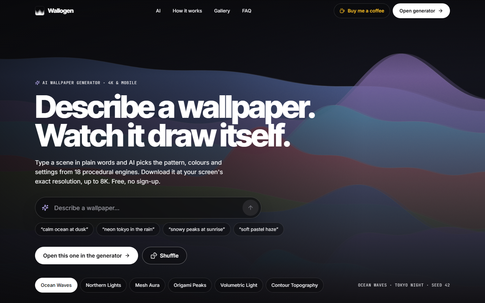
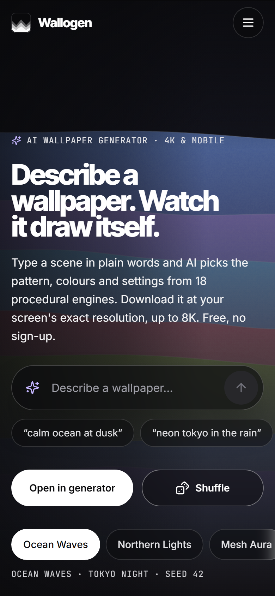
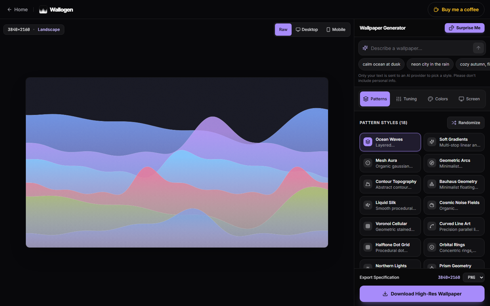
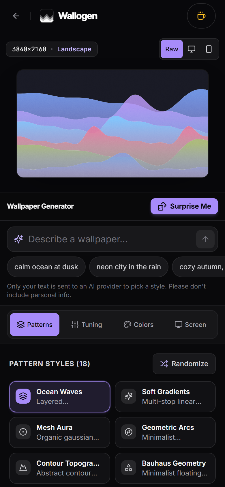

# Wallogen

Make your own wallpaper in a few seconds. Pick a style (or just describe one in words), tweak the colors, and download it at your screen's exact size, up to 8K.

Free. No sign-up. Your wallpaper is drawn right in your browser.

**Try it:** [wallogen.vercel.app](https://wallogen.vercel.app)

| Desktop | Mobile |
| --- | --- |
|  |  |
|  |  |

## What it does

- **18 styles:** waves, auroras, glass, mountains, light rays, and more.
- **Describe it:** type something like *"calm ocean at dusk"* and AI picks the style and colors for you.
- **Any screen:** presets for 4K and 8K monitors, ultrawides, iPhones, Android phones, and iPads. You can also type your own size.
- **Make it yours:** change the colors, size, detail, grain, and angle with sliders.
- **Private:** no accounts and no tracking. If you use the AI box, only the words you type are sent out. The image itself is never uploaded.

## Run it on your computer

You need [Node.js](https://nodejs.org/) 18 or newer.

```bash
git clone https://github.com/denzeltl/wallogen.git
cd wallogen
npm install
npm run dev
```

Then open [http://localhost:3000](http://localhost:3000).

### Turn on the AI box (optional)

The app works without this. Without a key, the AI box matches your words to a style on your device instead.

1. Get a free key from [Groq](https://console.groq.com/keys). A [Gemini](https://aistudio.google.com/apikey) key also works as a backup.
2. Copy `.env.example` to `.env.local` and paste your key(s) in.
3. Restart `npm run dev`.

Keep these keys secret. Don't commit `.env.local`.

## Other commands

| Command | What it does |
| --- | --- |
| `npm run build` | Builds the site for production |
| `npm run lint` | Checks the code for problems |
| `npm test` | Runs the tests |

## Built with

Next.js, TypeScript, Tailwind CSS, and the HTML5 Canvas.

Want to add your own style? See [ARCHITECTURE-ESSENTIALS.md](ARCHITECTURE-ESSENTIALS.md).

## Support

If Wallogen made your screen nicer, you can [buy me a coffee](https://buymeacoffee.com/denzeltl).

## License

[MIT](LICENSE)
